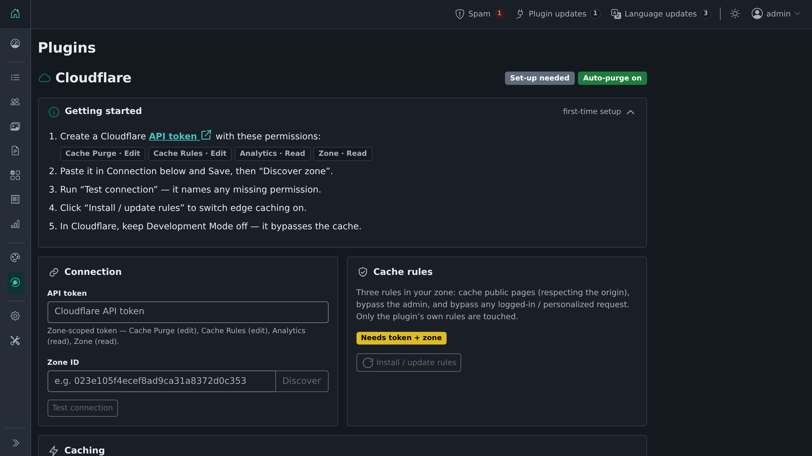

# Cloudflare

Connects a Shopclass site to Cloudflare. It purges changed pages, installs cache rules and shows cache analytics from the admin.

## Requirements

- Shopclass 6.2.0 or later, tested up to 6.4
- PHP 8.0 or later
- A Cloudflare account with your site as a zone, and an API token

## Install

1. Open Plugins → Browse (or upload the zip from the GitHub release).
2. Install.
3. Activate.

Or run `php oc-cli.php market:install cloudflare`.

## Set up

1. In Cloudflare, create a zone-scoped API token with these permissions:
   - Cache Purge: Edit
   - Cache Rules: Edit
   - Analytics: Read
   - Zone: Read
2. Open Plugins → Cloudflare. Paste the token into **API token** and click **Save changes**.
3. Click **Discover** to fill **Zone ID** from your site domain, or paste it. Click **Save changes**, then **Test connection**. It names any missing permission.
4. Click **Install / update rules**.
5. In Cloudflare, keep Development Mode off. It bypasses the cache.

## How it works

- **Automatic purge.** When a listing is created, edited, deleted or changes state (enabled, disabled, activated, deactivated, premium on or off, expiry changed), or a category or static page changes, the plugin purges the affected URLs. These are the item page (per enabled locale), the home page, the item's category listing, the seller's public profile and the sitemap index. All URLs come from core helpers.
- Purges never block a listing save. A failed purge is retried hourly for 48 hours, then dropped. The settings page shows how many were given up on. **Purge everything** clears that notice.
- **Full purge.** When core signals that every page changed (theme switch, site settings, permalinks, maintenance mode, plugin changes), the plugin purges the whole zone. At most one per minute. A skipped or failed one is retried hourly. A full purge also drops cached assets, so expect a short rise in origin traffic.
- **Cache rules.** One click installs three rules in the zone's cache phase: cache public pages (respecting the origin's `Cache-Control`), bypass `/oc-admin/*`, and bypass requests with a login or personalization cookie. The cookie list comes from core. Your other rules are kept. A page marked `private, no-store` is never cached.
- **Cache lifetime.** Tick **Set Cloudflare edge cache lifetime per page type** to set seconds for **Item pages** (default 300), **Static pages** (600) and **Listings** (home, search, category; 30). Off by default. The maximum is 86400. A longer time is safe because a change still purges the page.
- **Cache analytics.** A read-only panel shows the last 24 hours: cache hit ratio, requests and bandwidth from cache.

## Notes / limits

- Search and filter result URLs are not purged. They cannot be listed, so they follow the TTL in your cache rules.
- Cloudflare does not cache HTML by default, only static assets. Full purges matter when a rule makes it cache pages.
- Purge on deploy: `php oc-content/plugins/cloudflare/bin/purge.php` purges everything with the saved credentials.
- The plugin stores only the API token and Zone ID in the site's preferences. It talks only to the Cloudflare API over HTTPS and sends no telemetry.

## Support

https://github.com/mindstellar/shopclass-plugin-cloudflare/issues

## License

GPL-3.0-or-later. See [LICENSE](LICENSE).
